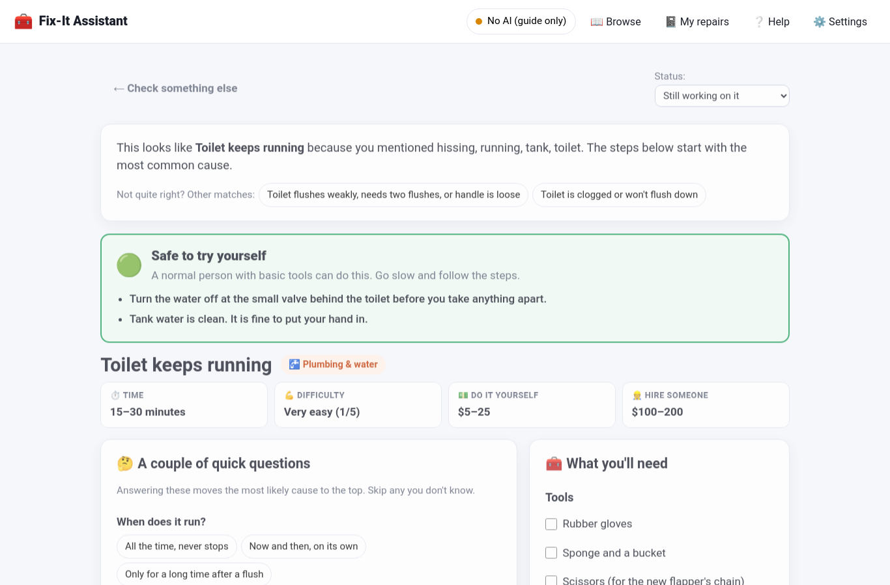

# 🧰 Fix-It Assistant

**Something's broken at home? Find out what it probably is, whether it's safe to fix yourself, what you need, and how — in plain words.**

Type what's happening ("the toilet keeps running and hisses"), add a photo if you like, and get:

- **A safety call, first.** 🟢 Safe to try · 🟡 Doable, be careful · 🟠 Call a pro · 🔴 Stop, safety first. This never comes from an AI — it's fixed, and it's cautious on purpose.
- **What it probably is**, ranked. Answer two quick questions and the list re-orders itself.
- **Step-by-step instructions** you can tick off, a **shopping list** with rough prices, how long it takes, and what a pro would charge.
- **"Stop and call a professional if…"** — the signs that mean this one isn't for you.
- **A chat box** to ask anything about *this* repair, in your own words.

It covers **47 of the most common household problems**: plumbing, electrical, appliances, heating & cooling, doors & windows, walls & floors, outdoor, car and bike basics. Eight real emergencies (gas smell, carbon monoxide, sparking outlets, sewage, a bulging ceiling…) are caught by rules and shown before anything else.

> **No AI required.** The whole repair guide, the safety system, the questions and the steps work with zero AI and zero internet. An AI (free, on your computer, or a cloud key) adds two things: reading a **photo**, and answering **follow-up questions** in natural language.



---

## Install (Linux — Ubuntu, Debian, Mint, Fedora…)

You need Python 3.10 or newer. Check with `python3 --version`.

```bash
git clone https://github.com/Sockshare/fix-it-assistant.git
cd fix-it-assistant
python3 -m venv .venv && source .venv/bin/activate
pip install -r requirements.txt
python app.py
```

Your browser opens at `http://127.0.0.1:8768`. That's it.

<details>
<summary>If <code>python3 -m venv</code> fails with "ensurepip is not available"</summary>

Ubuntu/Debian ship Python without the venv module. Either:

```bash
sudo apt install python3-venv     # then redo the venv line
```

or, with no admin rights:

```bash
python3 -m venv --without-pip .venv && source .venv/bin/activate
curl -sS https://bootstrap.pypa.io/get-pip.py | python -
pip install -r requirements.txt
```
</details>

Next time, just: `source .venv/bin/activate && python app.py`

---

## First run: pick how it should work

| Choice | What you get | Privacy |
|---|---|---|
| **🔒 No AI (guide only)** | The full guide, safety levels, steps, shopping lists, simple Q&A. Instant. | Nothing ever leaves your computer. |
| **💻 On my computer (Ollama)** | Everything above **plus** photo reading and natural-language questions. Free. | Nothing leaves your computer. Needs a one-time download. |
| **☁️ Cloud AI key** | Best photo reading and answers. Fast. | Your description and photo are sent to that company when you click. |

You can switch any time in ⚙️ Settings.

### Setting up the free local AI (optional)

```bash
curl -fsSL https://ollama.com/install.sh | sh
ollama pull llama3.2:3b      # answers questions (2 GB)
ollama pull moondream        # reads photos (1.7 GB)
```

Then in the app: ⚙️ Settings → **On my computer** → **Test** → **Save**. Any computer from the last ~8 years with 8 GB of RAM can run these. Answers take 20–60 seconds; photos 1–3 minutes.

---

## How to use it

1. **Describe the problem.** What the thing is, and what it's doing. The more specific, the better: *"kitchen sink drains slowly and smells"* beats *"sink broken"*. Tap a location chip (Plumbing, Electrical…) if you know it.
2. **Add a photo** (optional, needs an AI option on). Drop it on the box or click to choose. JPG or PNG.
3. Click **Figure it out**.
4. **Read the colored box first.** It tells you whether to go ahead, go carefully, or stop.
5. **Answer the quick questions** — the "what it probably is" list re-orders.
6. **Work through the steps.** Tick them off. The shopping list is on the right; **Copy** it to your phone.
7. Stuck? **Ask** in the chat box. "Which size flapper?" "Can I use pliers instead?" "Is this worth fixing on a 12-year-old dryer?"
8. Mark it **Fixed it! 🎉** (or *Called a pro*). It's saved in 📓 **My repairs** on this computer.

Not sure how to describe it? 📖 **Browse** lists every problem by room.

Full walkthrough with pictures: [docs/USER_GUIDE.md](docs/USER_GUIDE.md)

---

## Is it safe to trust?

The honest answer: it's a careful, well-organized guide, not a licensed tradesperson.

- The **safety level** and the **"stop and call a pro"** list for every problem were written by hand and can't be changed by the AI. When an AI is on, it is only allowed to pick from the guide's matches and explain them — and if it tries to call a pro-level job "easy", the app overrides it.
- **Emergencies** (gas, carbon monoxide, sparking, sewage, a bulging ceiling, a burst pipe, structural cracks) are detected by fixed rules and shown in red before anything else, no matter what else matched.
- Where the guide isn't sure, it says so, and gives you the other matches and the browse list instead of guessing.
- It leans conservative: electrical work beyond resetting a breaker is marked "careful" with a tester and breaker-off instructions; garage-door springs, microwaves, refrigerant and gas appliances are "call a pro".

If something feels wrong, stop. No repair is worth getting hurt, and a service call is cheaper than an ER visit.

---

## Privacy

- Runs on `127.0.0.1` only — nothing on your network can reach it.
- With **No AI** or **Ollama**, zero network traffic. The tests prove it with a socket guard.
- Saved repairs and settings live in `~/.fix_it_assistant/`, created private to your user (`600`/`700`). Turn off "Save the repairs I check" in Settings to keep nothing.
- With a cloud key, exactly your typed description, the photo you attached, and your chat question are sent — and only when you click. Never other saved repairs.
- Details: [docs/PRIVACY.md](docs/PRIVACY.md)

---

## Something not working?

```bash
python scripts/selfcheck.py
```

It checks Python, the packages, the settings file, Ollama, the port, and the guide itself, and tells you what to do. Every message the app can show is listed with its fix in [docs/TROUBLESHOOTING.md](docs/TROUBLESHOOTING.md). Common questions: [docs/FAQ.md](docs/FAQ.md).

---

## Quality

Every release passes nine gates: unit tests on the guide and the matcher, API tests, a fresh-install test in a clean venv, a real-browser click-through at three screen sizes, readability checks on all docs (grade 7 or below), a no-network privacy test, two independent reviews (a first-time user and a code/security review), and a run with a real local model. See [QUALITY.md](QUALITY.md).

```bash
pip install -r requirements-dev.txt && python -m playwright install chromium
pytest
```

## For developers

[docs/ARCHITECTURE.md](docs/ARCHITECTURE.md) explains the layout. Adding a problem to the guide is one dictionary in `fix_it_assistant/kb/` — the schema is documented at the top of `knowledge.py`, and the tests validate it.

## License

MIT. Use it, fork it, add your own repairs.
