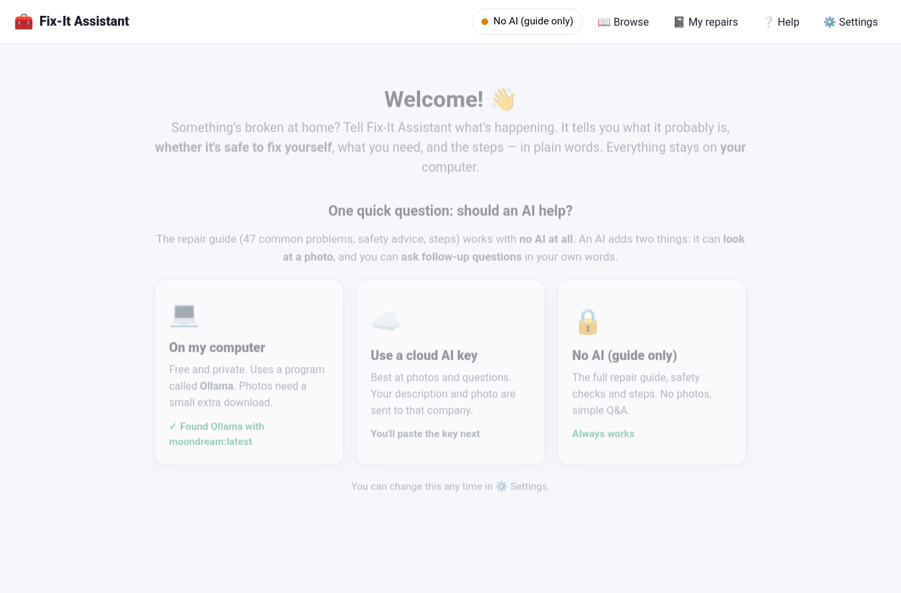
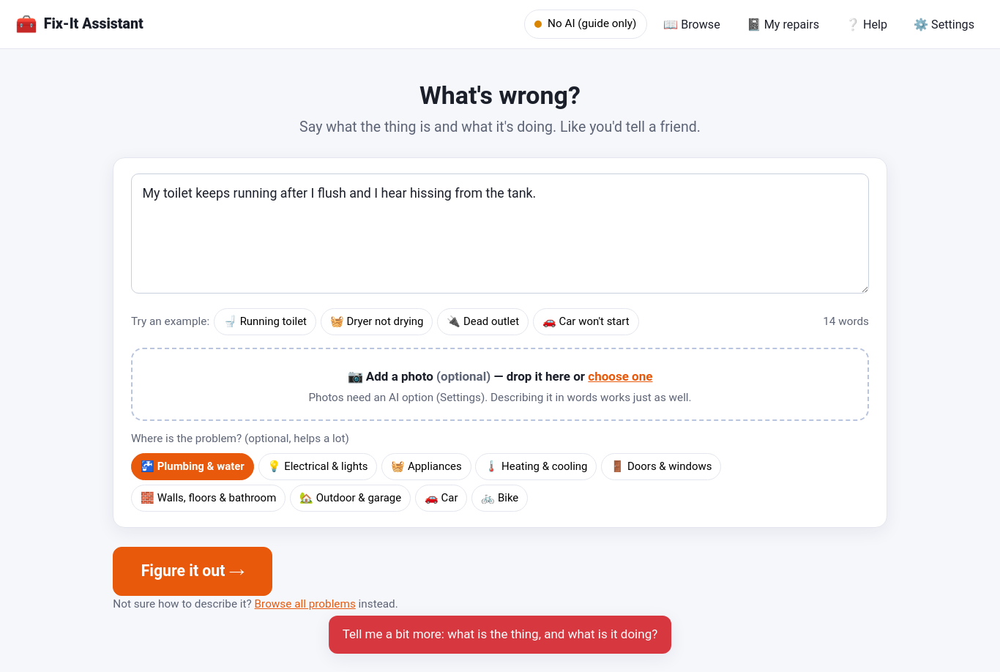
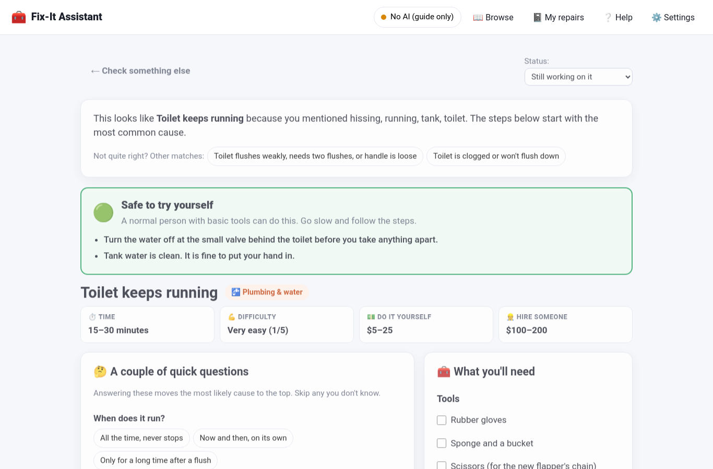
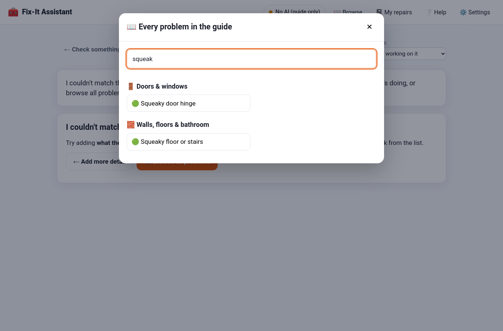
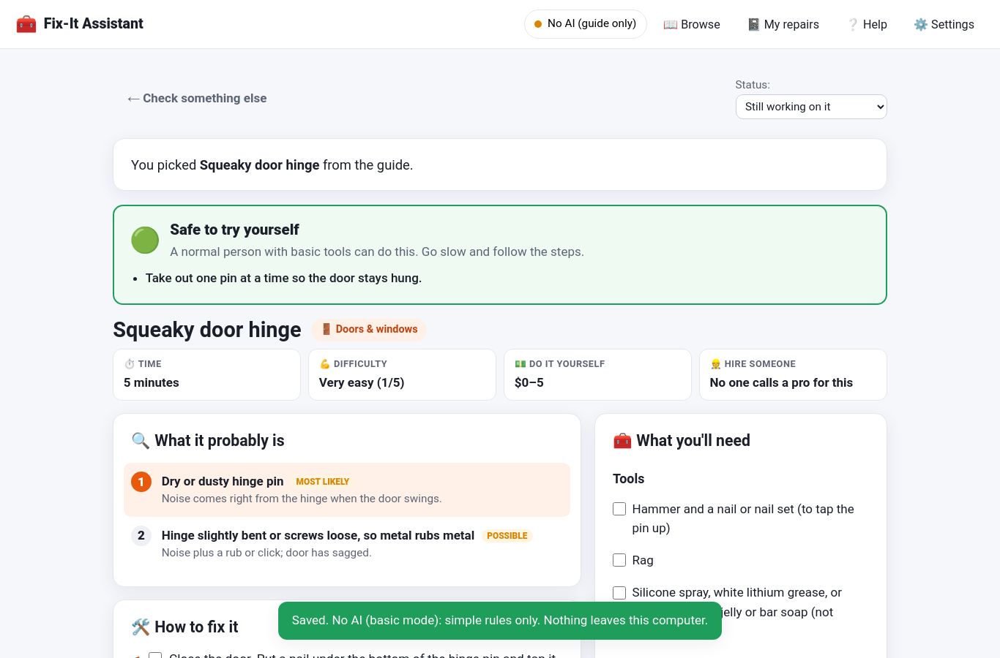

# User Guide

This walks through every screen. Plain words, no jargon.

## 1. First run

You pick how the app should work. You can change it later in ⚙️ Settings.

- **No AI (guide only)** — pick this if you're unsure. Everything works. You just can't use photos, and the chat box only answers simple questions.
- **On my computer** — the app looks for a free program called Ollama. If it's not there, it shows you the install steps.
- **Cloud AI key** — you paste a key from OpenAI or Google. Best quality, but your text and photo go to that company.

## 2. Describe the problem

Type what's wrong the way you'd tell a friend. Two things matter most:

1. **What the thing is**: toilet, dryer, outlet, front door, car.
2. **What it's doing**: keeps running, won't drain, hums, rubs at the top.

Good: *"The bathroom sink drains really slowly and gurgles."*
Not enough: *"Sink broken."*

**Try an example** buttons fill in a sample so you can see how it works.

**Add a photo** (optional). Drop a JPG or PNG on the box, or click it. The AI describes what it sees and adds that to your words. If you picked No AI, the photo is skipped — just describe what you see.

**Where is the problem?** Tap a chip like *Plumbing* or *Appliances*. It helps when your description is short.

Click **Figure it out**.

## 3. The results

Read top to bottom.

### 🔴 Red box at the very top (only sometimes)

If what you typed sounds like an emergency — a gas smell, carbon monoxide, sparks, sewage, a bulging ceiling, a burst pipe — a red box appears first with numbered steps. **Do those first.** They never come from the AI; they're fixed safety rules.

### What it looks like, and other matches

One or two sentences: "This looks like *Toilet keeps running* because you mentioned hissing, running, tank." If that's wrong, click one of the **other matches** chips to switch.

### The colored safety box

| Color | Meaning |
|---|---|
| 🟢 **Safe to try yourself** | Basic tools, normal person. Go slow. |
| 🟡 **Doable, but be careful** | Fine if you follow the safety notes exactly. Anything surprising: stop. |
| 🟠 **Call a professional** | Only the simple checks listed are for you. The real fix needs a pro. |
| 🔴 **Stop. Safety first.** | Don't fix it. Follow the safety steps and get help. |

The bullet points under it are the specific things to do (or not do) before you start — like "turn the water off at the valve behind the toilet."

### Quick facts

How long it takes, how hard it is (1–5), what it costs to do yourself, and what a pro usually charges. Rough US ranges.

### A couple of quick questions

Tap an answer. The "what it probably is" list re-orders itself and labels which cause *fits your answers*. Tap again to un-answer. Skip anything you don't know.

### What it probably is

Causes ranked most-likely first, with the signs that point to each one. The top one is highlighted.

### How to fix it

Numbered steps. Tick the checkbox as you finish each one. The steps start with the cheapest, most-common fix and work down. The yellow 💡 tip at the end is the one thing to remember.

### 🛑 Stop and call a professional if…

The signs that mean this has gone past a home repair. Read this before you start, not after.

### What you'll need (right side)

Tools and parts with rough prices. Tick what you have. **Copy shopping list** puts it on your clipboard to send to your phone.

### 💬 Ask about this repair

Type a question and press Enter. "Which size flapper do I buy?" "Can I use a butter knife instead of a putty knife?" "Is it worth fixing a 12-year-old dryer?"

- With an AI on: it answers in plain words, using this repair's guide. It won't tell you to do anything the guide marks as "call a pro".
- With No AI: it answers simple questions — tools, cost, time, safety, when to call a pro, what to do first.

### Status

Top right: *Still working on it*, *Fixed it! 🎉*, *Called a pro*, *Living with it*. It's saved to your notebook.

## 4. 📓 My repairs

Every problem you've checked, newest first, with its safety color and status. **Open** brings back the whole page including your chat. **Delete** removes one; **Delete all** clears everything.

If "Save the repairs I check" is off in Settings, entries say *not saved* and disappear when you close the app.

## 5. 📖 Browse

Every problem in the guide, grouped by room. Type a word to filter. Click one to open it directly — handy when you can't find the words to describe something, or just want to read up before it breaks.

## 6. ⚙️ Settings

- **Which AI**: the same three choices as the first run. For Ollama there are two model boxes: one for questions, one for photos (photos need a "vision" model like `moondream`).
- **Test**: checks the connection and tells you exactly what's wrong if it fails.
- **Save the repairs I check**: on by default. Off means nothing is written to disk.
- The grey line tells you where your data is stored.

## Tips from the guide

- The cheapest fix first. Most problems are the obvious thing: a filter, a loose screw, a tripped reset button.
- Take a photo before you take anything apart. Your future self will thank you.
- Turn off the water / power / gas before you touch it. Every single time.
- Buy the part by taking the old one to the store. Model numbers are on a sticker inside the door or on the back.
- When the guide says call a pro, it means it. The repair will still be there tomorrow; your fingers might not be.
